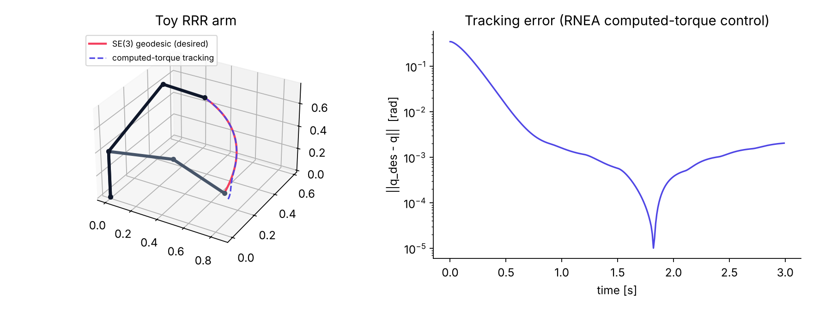
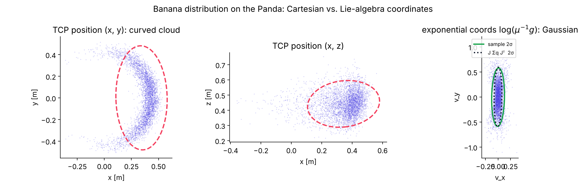
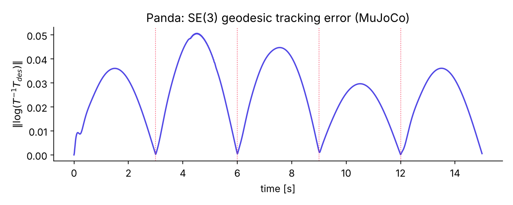

# LieAlgProblemExample — Motion planning on Lie groups

Companion code for the PBL lecture *Motion Planning on Lie Groups* (SO(3), SE(3), stochastic
kinematics, geodesic planning). Everything is plain NumPy except the physics, which is MuJoCo.

| Part | What it is |
|---|---|
| `liealg/so3.py`, `liealg/se3.py` | hat/vee, `exp`, `log`, adjoints, geodesic distance, SLERP / screw interpolation, product of exponentials, body/space Jacobians, Lie-group Newton IK |
| `liealg/manipulator.py` | **Toy 3-DoF (RRR) spatial arm** with real kinematics *and* dynamics: PoE forward kinematics, Jacobians, IK, recursive Newton–Euler on SE(3) (mass matrix, Coriolis/gravity, forward dynamics, RK4 simulator, computed-torque control) |
| `liealg/panda.py` + `models/` | **7-DoF Franka Emika Panda in MuJoCo** (model from [mujoco_menagerie](https://github.com/google-deepmind/mujoco_menagerie)). The screw axes are *extracted from the MJCF*, so the same PoE / Jacobian / IK code runs on the real robot and is checked against MuJoCo to 1e-15. A resolved-rate controller on SE(3) drives the position actuators along SE(3) geodesics in real time |
| `examples/` | the five demos below |
| `tests/` | pytest suite (Lie-group identities, Jacobians, dynamics consistency, energy conservation, PoE-vs-MuJoCo, IK convergence) |

## Homework assignment

The group assignment (plan on SE(3) → quantify uncertainty → execute on the real Panda with
ROS 2/Python, libfranka/C++ or MATLAB) is described in **[HOMEWORK.md](HOMEWORK.md)**, together with
the deliverables, safety rules and grading rubric.

## Install

```bash
git clone https://github.com/Grik301/LieAlgProblemExample
cd LieAlgProblemExample
pip install -e .          # numpy, scipy, matplotlib, mujoco
pytest -q                 # 10 tests
```

## Examples

```bash
python examples/01_lie_group_basics.py        # exp/log, geodesic distance, SLERP, screw motion
python examples/02_toy_manipulator.py         # RRR arm: IK on SE(3), RNEA dynamics, computed torque  -> figures/toy_arm.png
python examples/03_banana_distribution.py     # Panda: banana distribution, Cartesian vs log(mu^-1 g)  -> figures/banana_panda.png
python examples/04_panda_realtime.py          # Panda in MuJoCo, real-time viewer, SE(3) geodesic tracking
python examples/04_panda_realtime.py --headless   # same without a window                            -> figures/panda_tracking.png
python examples/05_panda_lie_vs_mujoco.py     # PoE / Jacobian / IK cross-checked against MuJoCo
```

### 1. The toy arm (`ToyArm3`)

Joint 1 rotates about *z*, joints 2–3 about *y*; links are rods with real inertia. Kinematics are the
product of exponentials `T(q) = exp([S1]q1) exp([S2]q2) exp([S3]q3) M`; dynamics are the
twist-based recursive Newton–Euler algorithm (Lynch & Park, Alg. 8.3), from which the mass matrix,
bias forces and forward dynamics are obtained. The example tracks an SE(3) geodesic with
computed-torque control and verifies energy conservation with zero torque and no gravity.



### 2. Banana distribution on the Panda

Gaussian joint noise pushed through the Panda's forward kinematics gives a *curved* end-effector
cloud in Cartesian coordinates, but in exponential coordinates `xi = log(mu^-1 g)` on se(3) it is
Gaussian, and its covariance is predicted to ~3 % by the first-order propagation
`Sigma = J_b Sigma_q J_b^T` (Long, Wolfe, Mashner & Chirikjian, RSS 2013).



### 3. Real-time Panda simulation (MuJoCo)

The target pose (RGB frame) moves along screw-motion geodesics
`T(s) = T_a exp(s log(T_a^-1 T_b))` between waypoints. At 100 Hz the controller measures the
body-twist error `e = log(T^-1 T_des)`, maps it to joint velocities with the damped pseudo-inverse of
the body Jacobian, integrates a reference position and hands it to MuJoCo's position actuators;
MuJoCo integrates the full dynamics at 500 Hz. `viewer.sync()` plus wall-clock sleeping keeps the
simulation in real time (headless it runs ~25× faster than real time).



```python
from liealg import se3
from liealg.panda import Panda

p = Panda(); p.reset()
T_des = se3.make(p.ee()[:3, :3], p.ee()[:3, 3] + [0.0, 0.2, -0.1])
for _ in range(300):               # 3 s
    e = p.resolved_rate(T_des)     # e = log(T^-1 T_des)
    p.step()                       # 5 MuJoCo steps
print(abs(e).max())                # ~1e-5
```

## Where the Lie-group machinery is used

* `se3.log` / `se3.exp` — all pose errors, interpolation and IK updates live in the Lie algebra; no
  Euler angles or quaternion arithmetic anywhere.
* `se3.poe`, `se3.body_jacobian` — one implementation for the toy arm and for the Panda
  (`Panda._extract_screws` reads the joint axes and anchors from MuJoCo at `q = 0`).
* `se3.ik_newton` — Newton's method on SE(3), quadratic convergence (see example 05).
* `ToyArm3.inverse_dynamics` — twists, adjoints and the Lie bracket `ad` do the Newton–Euler recursion.

## References

1. G. S. Chirikjian, *Stochastic Models, Information Theory, and Lie Groups*, Vols. 1–2, Birkhäuser 2009/2012.
2. A. W. Long, K. C. Wolfe, M. J. Mashner, G. S. Chirikjian, "The Banana Distribution is Gaussian: A Localization Study with Exponential Coordinates", RSS 2013.
3. J. Solà, J. Deray, D. Atchuthan, "A micro Lie theory for state estimation in robotics", arXiv:1812.01537.
4. K. M. Lynch, F. C. Park, *Modern Robotics*, Cambridge University Press 2017.

The Panda model in `models/franka_emika_panda` is from MuJoCo Menagerie (Apache-2.0 / BSD-3, see its LICENSE).
